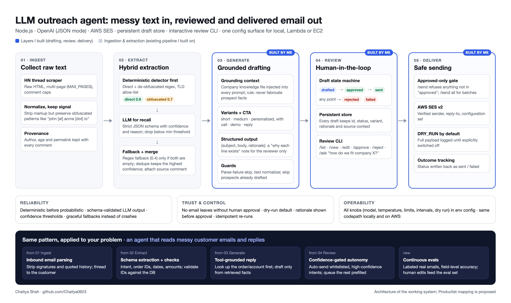

# Cold Email



**Sample data:** real drafts and the real company context are kept private. To run locally, start from the committed samples:

```bash
cp src/company_context.example.txt src/company_context.txt
cp data/drafts.example.json data/drafts.json   # optional: preload two sample drafts
```

Node.js pipeline that scrapes the live Hacker News item HTML (no official API usage), asks ChatGPT to discover obfuscated email addresses inside the thread (e.g., `john [at] gmail [dot] com`), and schedules AWS SES sends (with a default dry-run mode for local development).

## Requirements

- Node.js 20+
- OpenAI API key
- (Optional for real sends) AWS SES credentials with a verified sender identity

## Setup

1. Install dependencies:
   ```bash
   npm install
   ```
2. Copy the sample env file and fill it out:
   ```bash
   cp .env.example .env
   ```
3. Edit `.env` with:
   - `OPENAI_API_KEY`
   - `SOURCE_EMAIL` (must be verified in SES)
   - Set `DRY_RUN=false` plus AWS creds only when you are ready to actually send emails.
   - Tune scraping knobs such as `MAX_COMMENTS` and `MAX_PAGES` if you need to traverse longer threads.

## Usage

Run the pipeline by supplying a Hacker News thread URL:

```bash
npm start -- "https://news.ycombinator.com/item?id=123456"
```

such as 


```zsh
npm start -- "https://news.ycombinator.com/item?id=45800465"
```

NOTE: it must contain quotes otherwise the `?` will throw error in shell
What happens:

1. `hnCollector` fetches the raw Hacker News HTML pages (up to `MAX_PAGES`) and strips the comment text while keeping obfuscated address patterns intact.
2. `emailExtractor` first runs a deterministic detector that converts patterns such as `john [at] gmail [dot] com` or `amy at proton dot me` into proper emails, filters against a list of common TLDs to avoid garbage strings, then feeds the remaining comments to OpenAI for higher-recall extraction.
3. `emailScheduler` staggers emails using `SEND_INTERVAL_SECONDS`.
4. `emailSender` renders a simple template and calls AWS SES (or logs the payload when `DRY_RUN=true`).

All knobs (model selection, limits, delays, dry run, etc.) live in `.env` and are surfaced through `src/config.js`, so the same codepath works locally and in AWS (Lambda, EC2, etc.) without Terraform or Docker.

## Personalized Outreach CLI

An interactive terminal tool for generating, reviewing, and sending personalized cold emails using Lucia Protocol's value proposition.

### Launch

```bash
npm run cli
# or
npm run outreach
```

### Commands

| Command | Description |
|---|---|
| `/help` | Show all commands |
| `/list` | List unsent drafts |
| `/list all` | List all drafts |
| `/list <status>` | Filter by status (drafted/approved/sent/failed/rejected) |
| `/view <id>` | View full draft with "why this line exists" rationale |
| `/draft <email> [flags]` | Generate personalized drafts for a prospect |
| `/approve <id>` | Approve a draft for sending |
| `/reject <id>` | Reject a draft |
| `/edit <id>` | Edit subject & body inline |
| `/send <id>` | Send a single approved draft |
| `/send all` | Send all approved drafts |
| `/ask <question>` | Ask how Lucia fits a company/industry |
| `/collect <hn-url>` | Collect prospects from an HN thread |
| `/quit` | Exit |

### Draft generation flags

```bash
/draft user@company.com --name "Jane" --role "CTO" --company "Acme Inc" --context "Series B fintech" --cta demo --variant all
```

- `--variant`: `short` | `medium` | `personalized` | `all` (default: all — generates 3 variants)
- `--cta`: `call` | `demo` | `reply` (default: reply)

### Draft lifecycle

Each draft tracks: `id`, `prospectEmail`, `subject`, `body`, `status`, `rationale`, `variant`, `cta`.

Status flow: `drafted` → `approved` → `sent` (or `rejected` / `failed` at any point).

All state is persisted in `data/drafts.json`.
